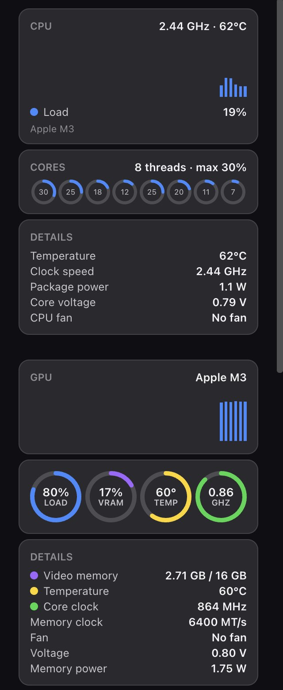
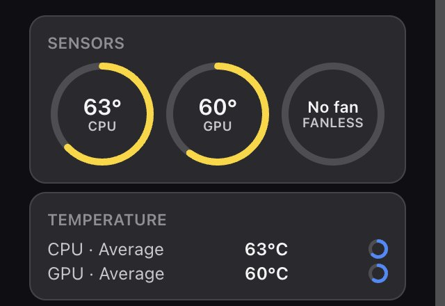

<div align="center">


# DeskStats

**Free, open-source system monitor widgets for Windows and macOS (Apple Silicon).**
**CPU, GPU, memory, temperatures, network and storage, floating on your desktop or docked in a sidebar.**

[](https://talhazahid.github.io/deskstats/downloads/DeskStats-Setup-1.0.17.exe)
&nbsp;
[-e8f1ff?style=for-the-badge&logo=apple&logoColor=black)](https://github.com/talhazahid/deskstats/releases/download/macos-v1.0.14/DeskStats-1.0.14-arm64.dmg)
&nbsp;
[](https://talhazahid.github.io/deskstats/)


<br>


</div>

---

## What is DeskStats?

DeskStats is a modern hardware monitor for **Windows** and **macOS**. It reads your CPU, GPU,
memory, drives, network and temperature sensors, and shows them as clean, glass-style widgets
that you can

- **float anywhere** on any monitor, or
- **dock into a sidebar** on the edge of the screen. Switch between the two in one click.

| | Windows | macOS |
|---|---|---|
| **Supported systems** | Windows 10 (2004+) and Windows 11, 64-bit | macOS 11 Big Sur or later |
| **Hardware** | Intel, AMD, NVIDIA, Intel Arc, laptops and desktops | Apple Silicon: M1, M2, M3, M4, M5 (all Pro/Max/Ultra variants) |
| **Lives in** | System tray | Menu bar |
| **Sensors via** | LibreHardwareMonitor + PawnIO driver | macmon (no sudo, no kernel extension) |
| **Download** | [Windows installer (.exe)](https://talhazahid.github.io/deskstats/downloads/DeskStats-Setup-1.0.17.exe) | [Mac disk image (.dmg)](https://github.com/talhazahid/deskstats/releases/download/macos-v1.0.14/DeskStats-1.0.14-arm64.dmg) |
| **Source** | [`src/`](src/) (.NET 8, WPF) | [`macos/`](macos/) (Electron) |

Intel Macs are not supported yet.

It is a **new version of [Sidebar Diagnostics](https://github.com/ArcadeRenegade/SidebarDiagnostics)**,
rebuilt from the ground up for today's Windows: .NET 8, a widget platform instead of a single
sidebar, resizable responsive widgets, per-widget themes, and universal hardware support
(Intel, AMD, NVIDIA, Intel Arc, laptops, multi-socket and ARM hints).

> **Not affiliated with** the original Sidebar Diagnostics project or its author.
> See [Credits & lineage](#credits--lineage) and [License](#license).

## Screenshots

<table>
  <tr>
    <td width="50%"><br><sub><b>Floating widgets</b>: CPU, GPU, memory and sensors, anywhere on the desktop.</sub></td>
    <td width="50%"><br><sub><b>Sidebar mode</b>: dock everything to the edge of any screen.</sub></td>
  </tr>
  <tr>
    <td width="50%"><br><sub><b>Every core, every clock</b>: per-thread load, real temperature, power, voltage and fan.</sub></td>
    <td width="50%"><br><sub><b>Real sensors</b>: temperatures and fan speeds read straight from your hardware.</sub></td>
  </tr>
  <tr>
    <td width="50%"><br><sub><b>Responsive</b>: drag a widget wider and its cards flow into 2 or 3 columns.</sub></td>
    <td width="50%"><br><sub><b>Make it yours</b>: theme, opacity and layer per widget.</sub></td>
  </tr>
  <tr>
    <td width="50%"><br><sub><b>On a MacBook Air (M3)</b>: CPU with core voltage and “No fan”, GPU with voltage and memory clock.</sub></td>
    <td width="50%"><br><sub><b>Fanless aware</b>: CPU and GPU temperatures on a passively cooled Mac.</sub></td>
  </tr>
</table>

<sub>Windows images are design renders of the real widgets. Colours and values on your PC will differ.</sub>

## Features

## Widgets

Every widget can float on its own or sit in the sidebar, and each one has its own settings, theme and size.

| Widget | What it shows | Windows | macOS |
|---|---|:---:|:---:|
| **CPU** | Total load with history graph, per-core/thread load rings (up to 256 threads), clock speed, temperature, package power, core voltage and CPU fan | ✅ | ✅ |
| **GPU** | Load, video memory (VRAM), core and hot-spot temperature, core and memory clock, fan and voltage. Picks the right GPU on hybrid laptops | ✅ | ✅ |
| **Memory (RAM)** | Used, available, committed and installed memory, swap, and the top apps by memory (up to 30) | ✅ | ✅ |
| **Hardware sensors** | CPU/GPU temperature rings, fan ring, and every temperature and fan sensor the hardware exposes. Fanless Macs show “No fan” | ✅ | ✅ |
| **Network** | Live download/upload speed with history, adapter picker, local and public IP, session totals | ✅ | ✅ |
| **Disks / Storage** | Capacity ring per drive, free space, live read/write speed and history | ✅ | ✅ |
| **Hardware power** | CPU, GPU and supported PSU power readings | ✅ | — |
| **Clock** | Big clock with date and a month calendar | ✅ | ✅ |
| **World Clock** | Current time in several time zones of your choice | ✅ | ✅ |
| **Weather** | Current conditions, feels-like, humidity, wind, UV, rain chance, air quality (US AQI), hourly and daily forecast, city search | ✅ | ✅ |
| **Now Playing** | Title, artist, album art, progress and play/pause/next controls for the media you are playing | ✅ | ✅ |
| **Recycle Bin / Trash** | Item count and size with a one-click empty action | ✅ | ✅ |

**macOS extras**

- **Core and GPU voltage** come from the chip's own DVFS tables at the live clock speed. Apple Silicon has no public voltage sensor.
- **Memory clock** shows the chip's rated unified-memory speed (for example M3: LPDDR5-6400), plus live memory power.
- **P- and E-cluster** clocks and voltages in the hardware report.

## Features

**Look & feel**

- **Responsive widgets**: drag the edges: 1 → 2 → 3 columns, balanced heights, titles pinned, content centred.
- **Dark & light themes for each widget**, with automatic text contrast so text stays readable on any wallpaper.
- **Background-only opacity** (0 to 100 %), optional card frame, transparent sidebar, optional sidebar title.
- **Floating or sidebar**: always on top, normal, or pinned to the desktop; click-through with a safe rescue; snap to grid; unlimited duplicates.
- **Multi-monitor aware**: screens are named by position and model, not by confusing numbers.
- **Layouts**: Minimal, Gaming, Work, Streaming presets, plus your own.

**Reliable**

- **Your setup is remembered.** Widgets, positions and settings are stored in `%LocalAppData%\DeskStats` (Windows) or `~/Library/Application Support/DeskStats` (macOS) and come back after every update or reinstall. A backup is taken automatically before a new version first runs.
- **Universal hardware support**: graceful fallbacks when a sensor is not available; a hardware report (tray → *Hardware report…*) helps debug unusual PCs.
- **Quiet**: low idle CPU, lives in the system tray (Windows) or menu bar (macOS), optional launch at login.
- **Privacy first**: no account, no telemetry, no ads. Hardware data never leaves your computer. See the [privacy policy](https://talhazahid.github.io/deskstats/privacy.html).

## Install

### Windows

1. Download **[`DeskStats-Setup-1.0.17.exe`](https://talhazahid.github.io/deskstats/downloads/DeskStats-Setup-1.0.17.exe)**.
2. Run it and accept the Windows (UAC) prompt.
3. Launch **DeskStats**. Right-click the tray icon → **Add widget**.

Silent install (for IT / package managers): `DeskStats-Setup-x.y.z.exe /VERYSILENT /SUPPRESSMSGBOXES /NORESTART`

**Why administrator rights?** Windows only lets apps read hardware sensors such as CPU temperature
with elevated rights. The installer also installs the free, signed
[PawnIO](https://pawnio.eu/) driver (if it is not already installed), which DeskStats uses to read
CPU sensors. Both are used only for reading sensors.

**Requirements:** Windows 10 (2004) or Windows 11, 64-bit. No .NET install needed. The app is self-contained.

### macOS (Apple Silicon)

1. Download **[`DeskStats-1.0.14-arm64.dmg`](https://github.com/talhazahid/deskstats/releases/download/macos-v1.0.14/DeskStats-1.0.14-arm64.dmg)** ([all Mac releases](https://github.com/talhazahid/deskstats/releases/tag/macos-v1.0.14)).
2. Open it and drag **DeskStats** into **Applications**.
3. The first time, right-click DeskStats → **Open** → **Open**, or go to System Settings → Privacy & Security → **Open Anyway**. The app is free and not notarized by Apple.
4. Click the DeskStats icon in the menu bar → **Add widget**.

Run it from Applications. Opening it from Downloads or Documents makes macOS ask for folder access before it starts.

**Requirements:** Apple Silicon Mac (M1 or newer), macOS 11 Big Sur or later. No sudo or extra drivers needed.

## Using it

| I want to… | Do this |
|---|---|
| Add a widget | Tray / menu bar icon → **Add widget** |
| Switch between floating and sidebar | Tray icon → **Switch to Widgets / Sidebar** |
| Resize a widget | Right-click it → **Resize width**, then drag the left or right edge |
| Change theme / opacity / layer | Right-click the widget → **Theme**, **Background opacity**, **Layer** |
| Edit a widget's settings | Right-click → **Settings…** (stays open so you can try several changes) |
| Save or load a layout | Tray icon → **Layouts** |
| Get a lost widget back | Tray icon → **Reset widget positions** |
| Report a hardware problem | Tray icon → **Hardware report…** and attach the file to an issue |

## Build from source

Prerequisites: Windows 10/11, the [.NET 8 SDK](https://dotnet.microsoft.com/download/dotnet/8.0).

```powershell
git clone https://github.com/talhazahid/deskstats.git
cd deskstats
dotnet build SysDash.sln -c Release
dotnet run --project src/SysDash.App
```

Make the installer (needs [Inno Setup 6](https://jrsoftware.org/isdl.php)):

```powershell
powershell -ExecutionPolicy Bypass -File scripts\build-release.ps1 -InstallSdk
```

The script publishes a self-contained single-file build, downloads the PawnIO setup and
produces `artifacts\DeskStats-Setup-<version>.exe`.

### macOS app

Prerequisites: an Apple Silicon Mac and Node.js 18+. Xcode is not required.

```sh
cd macos
npm install
npm start          # run from source
npm run pack       # build dist/DeskStats-darwin-arm64/DeskStats.app + zip
```

### Repository layout

```
src/
  SysDash.Core         models, MVVM primitives, units, history, logging, user-data safety
  SysDash.SDK          widget contract, window/host services, session
  SysDash.Monitoring   LibreHardwareMonitor wrapper, fallbacks, hardware report
  SysDash.Theming      dark/light themes, adaptive contrast, responsive layout panels
  SysDash.Layouts      layout persistence + presets
  SysDash.Widgets      the widget implementations
  SysDash.App          composition root, sidebar + floating windows, tray, settings
macos/                 macOS app for Apple Silicon (Electron): main process, widgets, sensor helpers
installer/             Inno Setup installer (bundles the PawnIO driver)
scripts/               build-release.ps1
docs/                  GitHub Pages website, compliance notes
```

> The internal project prefix `SysDash` is the codename the project started under; the product is **DeskStats**.

## Antivirus notes

DeskStats reads sensors through LibreHardwareMonitor and the PawnIO driver, the same approach used by
well-known hardware monitors. Some antivirus products can be suspicious of any app that talks to a
hardware driver. If yours flags DeskStats, add an exclusion for the install folder and report it as a
false positive to the vendor.

## Credits & lineage

DeskStats stands on the shoulders of other open-source work, and says so:

- **[Sidebar Diagnostics](https://github.com/ArcadeRenegade/SidebarDiagnostics)** by **ArcadeRenegade**
  (GPLv3): the original sidebar hardware monitor. DeskStats is a modernisation of that idea and adapts
  parts of its logic (sensor selection, unit conversion, multi-monitor / DPI handling, drive and network
  sampling). The exact files are listed in [`NOTICE`](NOTICE) and [`docs/COMPLIANCE.md`](docs/COMPLIANCE.md).
- **[LibreHardwareMonitor](https://github.com/LibreHardwareMonitor/LibreHardwareMonitor)** (MPL-2.0): hardware sensor access.
- **[PawnIO](https://pawnio.eu/)**: the signed kernel driver used to read CPU sensors.
- **[Open-Meteo](https://open-meteo.com/)**: weather and air-quality data (CC BY 4.0), free for non-commercial use.
- **[ipify](https://www.ipify.org/)**: public IP lookup (optional).
- **[macmon](https://github.com/vladkens/macmon)** (MIT): Apple Silicon sensors on macOS without sudo.
- **[nowplaying-cli](https://github.com/kirtan-shah/nowplaying-cli)**: Now Playing on macOS.
- **Hardcodet.NotifyIcon.Wpf**, **Microsoft.Extensions.DependencyInjection**: tray icon and dependency injection.

## License

DeskStats is licensed under the **[GNU General Public License v3.0](LICENSE)**: **it is not MIT-licensed.**

Because DeskStats adapts code from Sidebar Diagnostics, which is itself GPLv3, the whole project must
stay GPLv3. In plain words:

- ✅ **Use it**: free, for personal or work use.
- ✅ **Read, study and modify the source.**
- ✅ **Share it**: but if you distribute DeskStats or a modified version, you must keep it under GPLv3, give the
  recipients the source code, keep the copyright and credit notices (including the credit to Sidebar Diagnostics),
  and clearly mark your changes.
- ❌ **You can't make it closed-source**, re-license it under a permissive licence (such as MIT), or strip the credits.

**Name and artwork.** The *DeskStats* name, logo and app icon are *not* part of the GPL grant. Please do not use
them to name or brand a fork or a different product; choose your own name and artwork.

See [`NOTICE`](NOTICE) for third-party notices. This is a plain-language summary, not legal advice;
the [`LICENSE`](LICENSE) file is what counts.

## Contributing

Issues and pull requests are welcome. By contributing you agree that your contribution is licensed under GPLv3.
If you copy code from another project, keep its header and add it to [`NOTICE`](NOTICE).
When you report a hardware problem, please attach the file from tray → **Hardware report…**.

## Support

- Bugs and ideas: [GitHub Issues](https://github.com/talhazahid/deskstats/issues)
- X / Twitter: [@talhazahid56](https://x.com/talhazahid56)
- Discord: **talha56**
- Website and privacy policy: <https://talhazahid.github.io/deskstats/>

<div align="center"><sub>© 2026 DeskStats · Made for people who like to see what their computer is doing.</sub></div>
