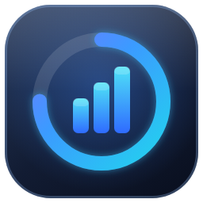
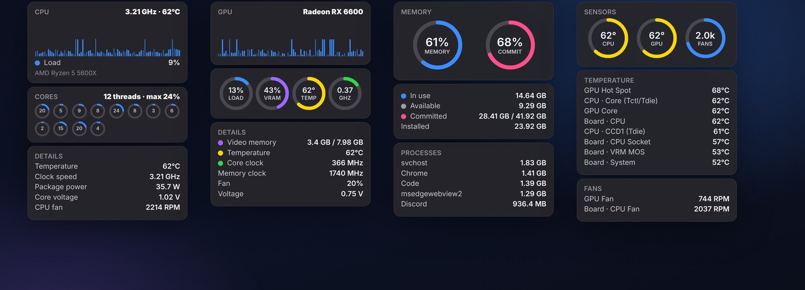
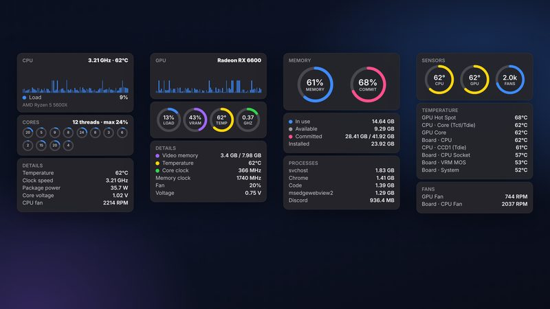
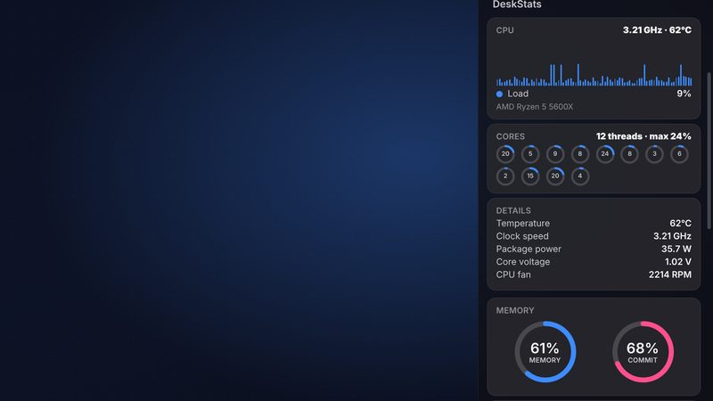
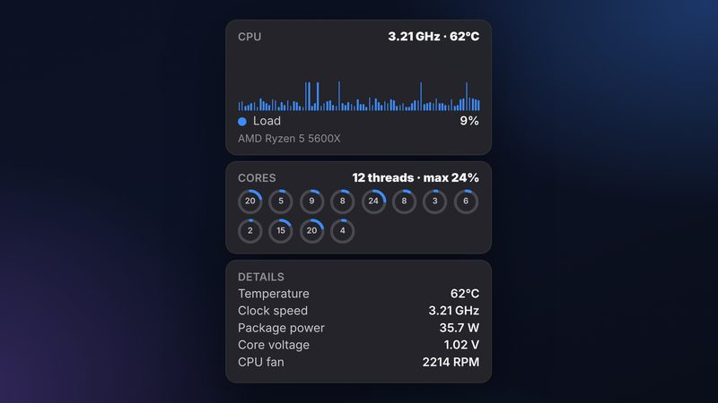
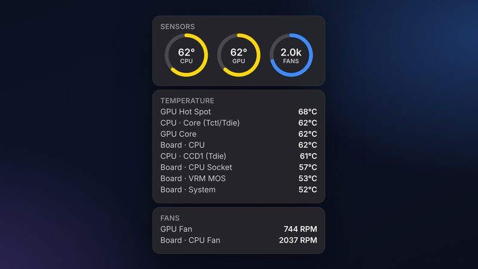
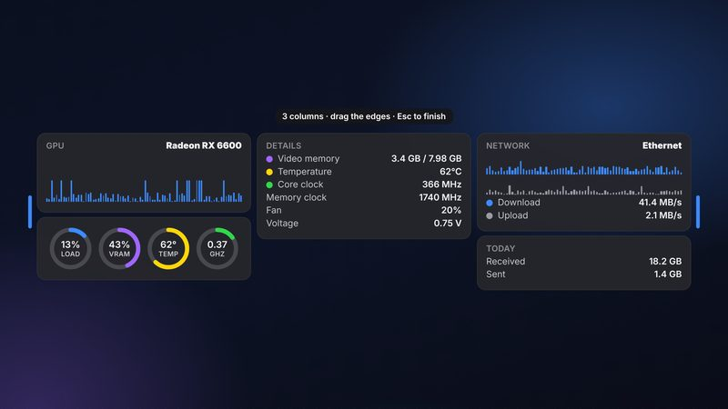
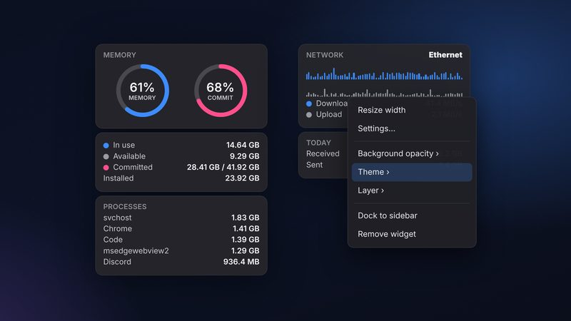

<div align="center">



# DeskStats

**Your PC's vitals, including CPU, GPU, memory, network and sensors, as beautiful widgets on your desktop, or docked in a sidebar.**

[](https://talhazahid.github.io/deskstats/downloads/DeskStats-Setup-1.0.17.exe)
&nbsp;
[-e8f1ff?style=for-the-badge&logo=apple&logoColor=black)](https://github.com/talhazahid/deskstats/releases/download/macos-v1.0.14/DeskStats-1.0.14-arm64.dmg)
&nbsp;
[](https://talhazahid.github.io/deskstats/)

-0b1020?style=flat-square)


<br>



</div>

---

## What is DeskStats?

> **New: DeskStats for Mac.** A native-feeling menu bar app for Apple Silicon Macs (M1–M5, macOS 11+)
> with CPU/GPU temperature, clocks, power, core voltage, memory and fanless-aware sensors.
> [Download the .dmg](https://github.com/talhazahid/deskstats/releases/download/macos-v1.0.14/DeskStats-1.0.14-arm64.dmg) · source in [`macos/`](macos/).

DeskStats is a modern hardware monitor for Windows. It reads your CPU, GPU, memory,
drives, network and every temperature and fan sensor your motherboard exposes, and
shows them as clean, glass-style widgets that you can

- **float anywhere** on any monitor, or
- **dock into a sidebar** on the edge of the screen. Switch between the two in one click.

It is a **new version of [Sidebar Diagnostics](https://github.com/ArcadeRenegade/SidebarDiagnostics)**,
rebuilt from the ground up for today's Windows: .NET 8, a widget platform instead of a single
sidebar, resizable responsive widgets, per-widget themes, and universal hardware support
(Intel, AMD, NVIDIA, Intel Arc, laptops, multi-socket and ARM hints).

> **Not affiliated with** the original Sidebar Diagnostics project or its author.
> See [Credits & lineage](#credits--lineage) and [License](#license).

## Screenshots

<table>
  <tr>
    <td width="50%"><br><sub><b>Floating widgets</b>: CPU, GPU, memory and sensors, anywhere on the desktop.</sub></td>
    <td width="50%"><br><sub><b>Sidebar mode</b>: dock everything to the edge of any screen.</sub></td>
  </tr>
  <tr>
    <td width="50%"><br><sub><b>Every core, every clock</b>: per-thread load, real temperature, power, voltage and fan.</sub></td>
    <td width="50%"><br><sub><b>Real sensors</b>: temperatures and fan speeds read straight from your hardware.</sub></td>
  </tr>
  <tr>
    <td width="50%"><br><sub><b>Responsive</b>: drag a widget wider and its cards flow into 2 or 3 columns.</sub></td>
    <td width="50%"><br><sub><b>Make it yours</b>: theme, opacity and layer per widget.</sub></td>
  </tr>
</table>

<sub>Images are design renders of the real widgets. Colours and values on your PC will differ.</sub>

## Features

**Monitoring**

- **CPU**: total load, per-thread load (up to 256 threads), effective clock, temperature, package power, core voltage, fan.
- **GPU**: load, VRAM, core and *hot-spot* temperature, core / memory clock, fan, voltage. Picks the right GPU automatically on hybrid laptops, and lets you choose when there are several.
- **Memory**: in use, available, committed, installed, and the **top apps by memory (up to 30)**.
- **Sensors**: every motherboard temperature and fan in one place.
- **Network**: live download / upload with history, adapter choice, today's totals, optional public IP.
- **Storage**: capacity and read / write activity per drive.
- **Date & time, World clock**: clock with calendar, several time zones.
- **Weather**: current conditions, humidity, rain chance, wind, **air quality (US AQI)**, feels-like, UV, dew point, visibility, hourly and daily forecast. City search with autocomplete (type "kar" → *Karachi, Sindh, Pakistan*).
- **Extras**: Now Playing, Recycle Bin.

**Look & feel**

- **Responsive widgets**: drag the edges: 1 → 2 → 3 columns, balanced heights, titles pinned, content centred.
- **Dark & light themes for each widget**, with automatic text contrast so text stays readable on any wallpaper.
- **Background-only opacity** (0 to 100 %), optional card frame, transparent sidebar, optional sidebar title.
- **Floating or sidebar**: always on top, normal, or pinned to the desktop; click-through with a safe rescue; snap to grid; unlimited duplicates.
- **Multi-monitor aware**: screens are named by position and model, not by confusing numbers.
- **Layouts**: Minimal, Gaming, Work, Streaming presets, plus your own.

**Reliable**

- **Your setup is remembered.** Widgets, positions and settings are stored in `%LocalAppData%\DeskStats` and come back after every update or reinstall. A backup is taken automatically before a new version first runs.
- **Universal hardware support**: graceful fallbacks when a sensor is not available; a hardware report (tray → *Hardware report…*) helps debug unusual PCs.
- **Quiet**: low idle CPU, lives in the system tray, starts with Windows.
- **Privacy first**: no account, no telemetry, no ads. Hardware data never leaves your PC. See the [privacy policy](https://talhazahid.github.io/deskstats/privacy.html).

## Install

1. Download **`DeskStats-Setup-x.y.z.exe`** from the [latest release](https://github.com/talhazahid/deskstats/releases/latest).
2. Run it and accept the Windows (UAC) prompt.
3. Launch **DeskStats**. Right-click the tray icon → **Add widget**.

Silent install (for IT / package managers): `DeskStats-Setup-x.y.z.exe /VERYSILENT /SUPPRESSMSGBOXES /NORESTART`

**Why administrator rights?** Windows only lets apps read hardware sensors such as CPU temperature
with elevated rights. The installer also installs the free, signed
[PawnIO](https://pawnio.eu/) driver (if it is not already installed), which DeskStats uses to read
CPU sensors. Both are used only for reading sensors.

**Requirements:** Windows 10 (2004) or Windows 11, 64-bit. No .NET install needed. The app is self-contained.

## Using it

| I want to… | Do this |
|---|---|
| Add a widget | Tray icon → **Add widget** |
| Switch between floating and sidebar | Tray icon → **Switch to Widgets / Sidebar** |
| Resize a widget | Right-click it → **Resize width**, then drag the left or right edge |
| Change theme / opacity / layer | Right-click the widget → **Theme**, **Background opacity**, **Layer** |
| Edit a widget's settings | Right-click → **Settings…** (stays open so you can try several changes) |
| Save or load a layout | Tray icon → **Layouts** |
| Get a lost widget back | Tray icon → **Reset widget positions** |
| Report a hardware problem | Tray icon → **Hardware report…** and attach the file to an issue |

## Build from source

Prerequisites: Windows 10/11, the [.NET 8 SDK](https://dotnet.microsoft.com/download/dotnet/8.0).

```powershell
git clone https://github.com/talhazahid/deskstats.git
cd deskstats
dotnet build SysDash.sln -c Release
dotnet run --project src/SysDash.App
```

Make the installer (needs [Inno Setup 6](https://jrsoftware.org/isdl.php)):

```powershell
powershell -ExecutionPolicy Bypass -File scripts\build-release.ps1 -InstallSdk
```

The script publishes a self-contained single-file build, downloads the PawnIO setup and
produces `artifacts\DeskStats-Setup-<version>.exe`.

### Repository layout

```
src/
  SysDash.Core         models, MVVM primitives, units, history, logging, user-data safety
  SysDash.SDK          widget contract, window/host services, session
  SysDash.Monitoring   LibreHardwareMonitor wrapper, fallbacks, hardware report
  SysDash.Theming      dark/light themes, adaptive contrast, responsive layout panels
  SysDash.Layouts      layout persistence + presets
  SysDash.Widgets      the widget implementations
  SysDash.App          composition root, sidebar + floating windows, tray, settings
installer/             Inno Setup installer (bundles the PawnIO driver)
scripts/               build-release.ps1
docs/                  GitHub Pages website, compliance notes
```

> The internal project prefix `SysDash` is the codename the project started under; the product is **DeskStats**.

## Antivirus notes

DeskStats reads sensors through LibreHardwareMonitor and the PawnIO driver, the same approach used by
well-known hardware monitors. Some antivirus products can be suspicious of any app that talks to a
hardware driver. If yours flags DeskStats, add an exclusion for the install folder and report it as a
false positive to the vendor.

## Credits & lineage

DeskStats stands on the shoulders of other open-source work, and says so:

- **[Sidebar Diagnostics](https://github.com/ArcadeRenegade/SidebarDiagnostics)** by **ArcadeRenegade**
  (GPLv3): the original sidebar hardware monitor. DeskStats is a modernisation of that idea and adapts
  parts of its logic (sensor selection, unit conversion, multi-monitor / DPI handling, drive and network
  sampling). The exact files are listed in [`NOTICE`](NOTICE) and [`docs/COMPLIANCE.md`](docs/COMPLIANCE.md).
- **[LibreHardwareMonitor](https://github.com/LibreHardwareMonitor/LibreHardwareMonitor)** (MPL-2.0): hardware sensor access.
- **[PawnIO](https://pawnio.eu/)**: the signed kernel driver used to read CPU sensors.
- **[Open-Meteo](https://open-meteo.com/)**: weather and air-quality data (CC BY 4.0), free for non-commercial use.
- **[ipify](https://www.ipify.org/)**: public IP lookup (optional).
- **Hardcodet.NotifyIcon.Wpf**, **Microsoft.Extensions.DependencyInjection**: tray icon and dependency injection.

## License

DeskStats is licensed under the **[GNU General Public License v3.0](LICENSE)**: **it is not MIT-licensed.**

Because DeskStats adapts code from Sidebar Diagnostics, which is itself GPLv3, the whole project must
stay GPLv3. In plain words:

- ✅ **Use it**: free, for personal or work use.
- ✅ **Read, study and modify the source.**
- ✅ **Share it**: but if you distribute DeskStats or a modified version, you must keep it under GPLv3, give the
  recipients the source code, keep the copyright and credit notices (including the credit to Sidebar Diagnostics),
  and clearly mark your changes.
- ❌ **You can't make it closed-source**, re-license it under a permissive licence (such as MIT), or strip the credits.

**Name and artwork.** The *DeskStats* name, logo and app icon are *not* part of the GPL grant. Please do not use
them to name or brand a fork or a different product; choose your own name and artwork.

See [`NOTICE`](NOTICE) for third-party notices. This is a plain-language summary, not legal advice;
the [`LICENSE`](LICENSE) file is what counts.

## Contributing

Issues and pull requests are welcome. By contributing you agree that your contribution is licensed under GPLv3.
If you copy code from another project, keep its header and add it to [`NOTICE`](NOTICE).
When you report a hardware problem, please attach the file from tray → **Hardware report…**.

## Support

- Bugs and ideas: [GitHub Issues](https://github.com/talhazahid/deskstats/issues)
- Website and privacy policy: <https://talhazahid.github.io/deskstats/>

<div align="center"><sub>© 2026 DeskStats · Made for people who like to see what their PC is doing.</sub></div>
